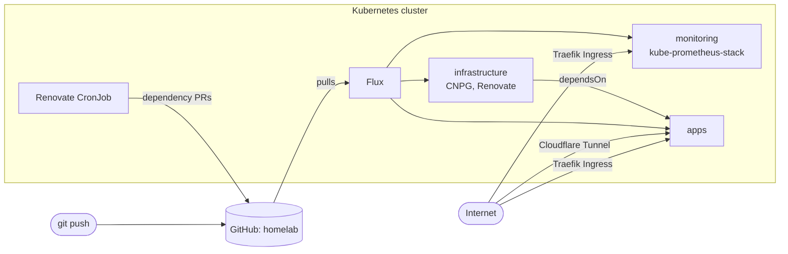

# homelab

GitOps configuration for my Kubernetes homelab. [Flux](https://fluxcd.io/) continuously reconciles the cluster against this repo, so the repo is the single source of truth.

## Overview



- **Reconciliation** is split into Flux `Kustomization`s under `clusters/staging/`: `infrastructure-controllers`, `monitoring-controllers`, `monitoring-configs` and `apps`. `apps` waits for `infrastructure-controllers`, so operators and their CRDs (e.g. CloudNativePG) exist before the workloads that use them.
- **Ingress** is either a per-app Cloudflare Tunnel (`cloudflared`, no port forwarding) or the cluster's Traefik ingress controller.
- **Secrets** are committed encrypted with SOPS + age and decrypted by Flux in-cluster.

> **Why "staging"?** It's currently the only environment. The layout follows the [Flux example repo](https://github.com/fluxcd/flux2-kustomize-helm-example), which leaves room for more clusters under `clusters/`.

## Stack

| Concern | Tool |
|---------|------|
| GitOps | [Flux](https://fluxcd.io/) + [Kustomize](https://kustomize.io/) |
| Secrets | [SOPS](https://github.com/getsops/sops) + [age](https://github.com/FiloSottile/age) |
| Ingress | [Traefik](https://traefik.io/), [Cloudflare Tunnel](https://developers.cloudflare.com/cloudflare-one/connections/connect-networks/) |
| Databases | [CloudNativePG](https://cloudnative-pg.io/) |
| Monitoring | [kube-prometheus-stack](https://github.com/prometheus-community/helm-charts/tree/main/charts/kube-prometheus-stack) (Prometheus, Alertmanager, Grafana) |
| Dependency updates | [Renovate](https://docs.renovatebot.com/) (self-hosted) |

## Apps

| App | Description | Exposed via |
|-----|-------------|-------------|
| [linkding](https://github.com/sissbruecker/linkding) | Self-hosted bookmark manager | Cloudflare Tunnel |
| [audiobookshelf](https://github.com/advplyr/audiobookshelf) | Audiobook and podcast server | Cloudflare Tunnel |
| [homepage](https://github.com/gethomepage/homepage) | Dashboard linking the homelab services | Traefik Ingress |
| website | Personal website | Cloudflare Tunnel |
| health-vitals | Hourly job that syncs health data into Postgres, visualised in Grafana | Internal only |

## Repo layout

Each area uses environment-agnostic `base/` manifests plus a per-environment overlay that layers in config and secrets.

```
apps/
  base/          # app manifests (Kustomize bases)
  staging/       # app overlays + secrets
infrastructure/
  controllers/
    base/        # cluster tooling (CloudNativePG, Renovate)
    staging/     # overlays
monitoring/
  controllers/   # kube-prometheus-stack HelmRelease
  configs/       # Grafana datasources + secrets
clusters/
  staging/       # Flux entrypoint: per-domain Kustomizations
    flux-system/ # generated by `flux bootstrap` — do not edit
```
